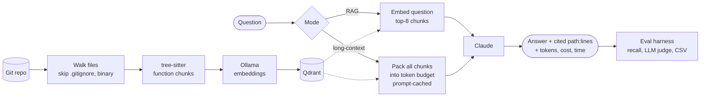

# CodeLens

Ask questions about a codebase. CodeLens answers in two ways and measures both:

- **RAG** — find the code chunks closest to the question, send only those to Claude.
- **Long-context** — put as much of the repo as fits straight into Claude's prompt.

It is also the test setup for a research paper: *RAG vs. long-context LLMs for
understanding code repositories*. Full plan: [PLAN.md](PLAN.md).



## Quick start (one command)

Needs Docker. Put your key in `.env` first (`copy .env.example .env`, then fill in
`ANTHROPIC_API_KEY`). Without a key, everything works except the Claude answer.

```bash
docker compose up -d --build
```

This starts Qdrant, Ollama (and downloads the embedding model once), the API and the demo page:

- demo page: http://localhost:8501
- API docs: http://localhost:8000/docs
- Qdrant dashboard: http://localhost:6333/dashboard

Index a repo from inside Docker (mount it read-only as `/repo`):

```bash
docker compose run --rm -v "D:/path/to/repo:/repo:ro" api codelens ingest /repo --repo-id my-repo
```

Then open the demo page, pick the repo, pick a mode and ask. The page shows the answer,
the chunks Claude saw (cited ones marked), and the cost: tokens, dollars and seconds.
The page only talks to the HTTP API, the same way `curl` would.

## Using DeepSeek instead of Claude

CodeLens can answer (and judge) with DeepSeek through its Anthropic-format API. Put this in `.env`:

```
CODELENS_PROVIDER=deepseek
DEEPSEEK_API_KEY=sk-...
```

What changes in DeepSeek mode:

| | Claude (default) | DeepSeek |
|---|---|---|
| Model | `CODELENS_CLAUDE_MODEL` (Opus 5.5) | `CODELENS_DEEPSEEK_MODEL` (`deepseek-flash`) |
| Prompt caching (long-context) | Yes: the repo is paid in full once, then cheaply | No: DeepSeek ignores `cache_control`, so every long-context question pays for the whole packed repo |
| Token counts for packing | Exact, from the count-tokens endpoint | Estimated: characters / 3.5 x 1.10 (slight over-count keeps the packer under budget) |
| Effort setting, refusal fallback | Used | Not sent |
| Prices in the cost log | Claude prices | DeepSeek Flash peak-hour rate: $0.30 / 1M input, $1.20 / 1M output |

Results from the two providers are not comparable as one experiment: report which model produced each number.

## Status

- **Phase 0 — setup:** done. Layout, core models and interfaces, `/health` API, Docker services, CI.
- **Phase 1 — ingestion:** done. `codelens ingest` walks a repo (respecting `.gitignore`, skipping
  binary and huge files), cuts code into function chunks with tree-sitter, embeds them in batches
  with Ollama and stores them in Qdrant. Re-running only redoes changed files; deleted files lose
  their chunks.
- **Phase 2 — RAG answers:** done. `POST /ask` and `codelens ask` embed the question, take the
  8 closest chunks of that repo, and ask Claude to answer from them only, citing `path:start-end`.
  Every call's tokens, cost and latency go to `.codelens/cost_log.csv`.
- **Phase 3 — long-context answers:** done. `mode: "long_context"` sends every chunk of the repo
  that fits a token budget (default 100,000), whole files in priority order, as one
  prompt-cached block. Same chunks and same system prompt as RAG, so only the selection differs.
- **Phase 4 — evaluation harness:** done. `codelens eval run` answers a question set in both
  modes, scores each answer (file recall + an LLM judge), and writes one CSV row per answer;
  `codelens eval summarize` turns it into a table per mode and question type.
- **Phase 5 — portfolio polish:** done. Streamlit demo page, `GET /repos`, one-command Docker
  setup, diagram. A demo GIF follows the first run with a real API key.
- **Next:** run the pilot with a real API key; the paper's literature review.

## Stack

Python 3.12 · FastAPI · Qdrant · Ollama (local embeddings) · tree-sitter · Claude ·
uv · pytest · ruff · mypy

## Layout

```
src/codelens/
  core/          models + Protocols (standard library only — a test enforces it)
  chunking/      source files -> chunks                       (Phase 1)
  embedding/     chunks -> vectors (Ollama)                   (Phase 1)
  vectorstore/   Qdrant                                       (Phase 1)
  ingestion/     walk repo, embed in batches, store           (Phase 1)
  llm/           Claude calls, token counting, cost           (Phase 2)
  answering/     RAG and long-context answerers               (Phases 2-3)
  api/           FastAPI app: GET /health, GET /repos, POST /ask
  evaluation/    question sets, scoring, CSV results          (Phase 4)
  ui/            Streamlit demo page (an API client)          (Phase 5)
analysis/        paper tables and charts
tests/
```

## Run for development (without Docker for the app)

Needs Ollama installed on your PC (`ollama pull nomic-embed-text`) and Qdrant
(`docker compose up -d qdrant`).

```bash
uv sync
copy .env.example .env                     # then add your ANTHROPIC_API_KEY
uv run uvicorn codelens.api.app:app --reload
uv run streamlit run src/codelens/ui/streamlit_app.py
```

Index a repo (run it again after edits: only changed files are redone):

```bash
uv run codelens ingest path/to/repo --repo-id my-repo
```

Ask a question (needs `ANTHROPIC_API_KEY` in `.env`):

```bash
uv run codelens ask "how are snippet ids assigned?" --repo-id my-repo
```

Or over HTTP:

```bash
curl -X POST http://127.0.0.1:8000/ask -H "Content-Type: application/json" -d "{\"repo_id\": \"my-repo\", \"question\": \"how are snippet ids assigned?\"}"
```

The response has the answer, `sources` (chunks shown to Claude, best first), `cited` (the ones
the answer actually cites — made-up citations are dropped), and `cost` (tokens, dollars, seconds).

## How a RAG answer works

```
question -> Ollama (1 request) -> Qdrant: 8 closest chunks of this repo
         -> Claude: system prompt "answer only from these excerpts, cite path:start-end"
         -> answer + sources + cited + cost  -> one row in .codelens/cost_log.csv
```

## How a long-context answer works

```
all chunks of the repo (read back from Qdrant, same content RAG searches)
  -> group by file; order: root README/docs, source, tests, config; then by path
  -> take whole files while the estimate (chars / 3) fits the budget
  -> check with ONE exact token count; drop files from the end if over
  -> Claude: [system prompt][repo block, cached][question]
  -> answer + cited + cost + context_truncated
```

Cost example — a repo of ~10,700 tokens on Opus 5.5 (prices per 1M tokens):
- first question: 10,700 cache-write tokens x $5.00 = $0.054, plus output
- next questions within 5 minutes: 10,700 cache-read tokens x $0.20 = $0.002, plus output
- without caching every question would pay 10,700 x $4.00 = $0.043 input

```bash
uv run codelens ask "how is the app structured?" --repo-id my-repo --mode long_context
```

Errors: Ollama or Qdrant down -> 503, no Claude key -> 503 with a plain message,
Claude failure -> 502. Internal details go only to the server log.

## Evaluation (for the paper)

A question set is JSON: each question has a repo, a type (`locate`, `explain_flow`,
`architecture`), a reference answer and the files that hold the answer.
A pilot set for the fastapi-basics repo is in [datasets/fastapi-basics.json](datasets/fastapi-basics.json).

```bash
uv run codelens eval run datasets/fastapi-basics.json --out results/pilot.csv --max-cost 1
uv run codelens eval summarize results/pilot.csv
```

Each row scores one answer:

| Column | Meaning |
|---|---|
| `retrieval_recall` | share of expected files among the chunks shown to Claude (RAG: did search find them? long-context: did they fit?) |
| `cited_recall`, `cited_precision` | did the answer cite the expected files, and only those? |
| `judge_score` | 0 wrong / 1 partial / 2 correct, from an LLM judge that sees the question, the reference and the answer — not the code or the mode |
| tokens, `answer_cost_usd`, `judge_cost_usd`, `latency_seconds` | cost and speed |

Built for paid runs: rows are written as they finish, re-running the same `--out` resumes,
`--max-cost` stops before overspending, one failing question is recorded and skipped.
Long-context questions for one repo run back to back so the cached repo block is reused.
Hand-check a random sample of judge scores and report the agreement.

Pilot estimate (9 questions x 2 modes + judge, Opus 5.5, ~10,700-token repo): about **$0.45**.
- RAG: 9 x (~1,400 input x $4 + ~600 output x $20) / 1M = ~$0.16
- Long-context: 10,700 cache write x $5 / 1M = $0.054 once, then 8 x 10,700 cache read x $0.20 / 1M = $0.017, plus 9 x ~600 output x $20 / 1M = $0.11 -> ~$0.18
- Judge: 18 x (~500 input x $4 + ~150 output x $20) / 1M = ~$0.09
A refusal is returned as an answer with `refused: true`, and still logged, because it still costs.

## How ingestion works

```
repo -> walk (skip .gitignore, binary, > 500 KB) -> SHA-256 per file
     -> compare with last run's hashes (.codelens/<repo>.files.json)
     -> delete chunks of changed + deleted files (one Qdrant call)
     -> chunk changed files: one chunk per function (tree-sitter), line windows for the rest
     -> embed in batches of 64 (one Ollama request per batch)
     -> upsert each batch (one Qdrant call per batch)
     -> save the new hashes last, so a failed run is simply redone next time
```

## Checks (same as CI)

```bash
uv run ruff check .
uv run ruff format --check .
uv run mypy src tests
uv run pytest
```
